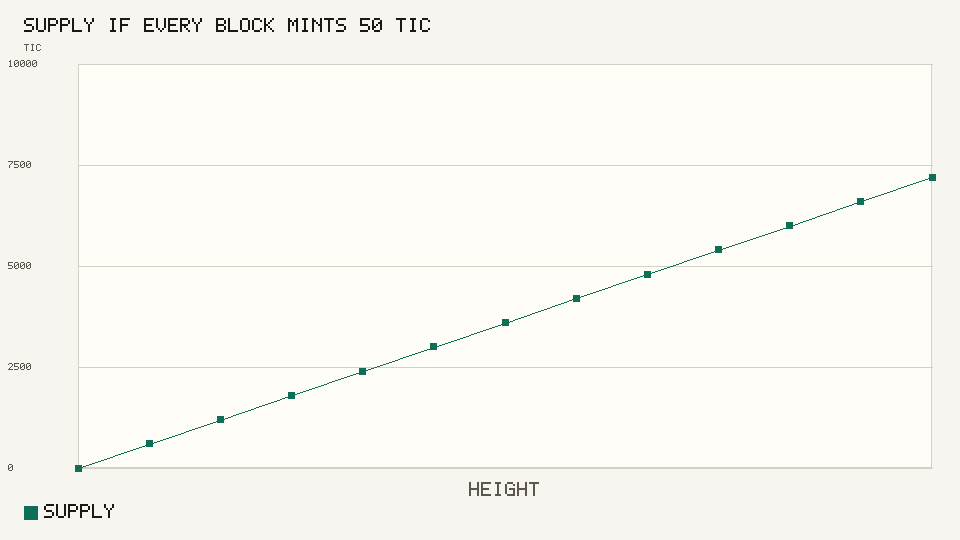
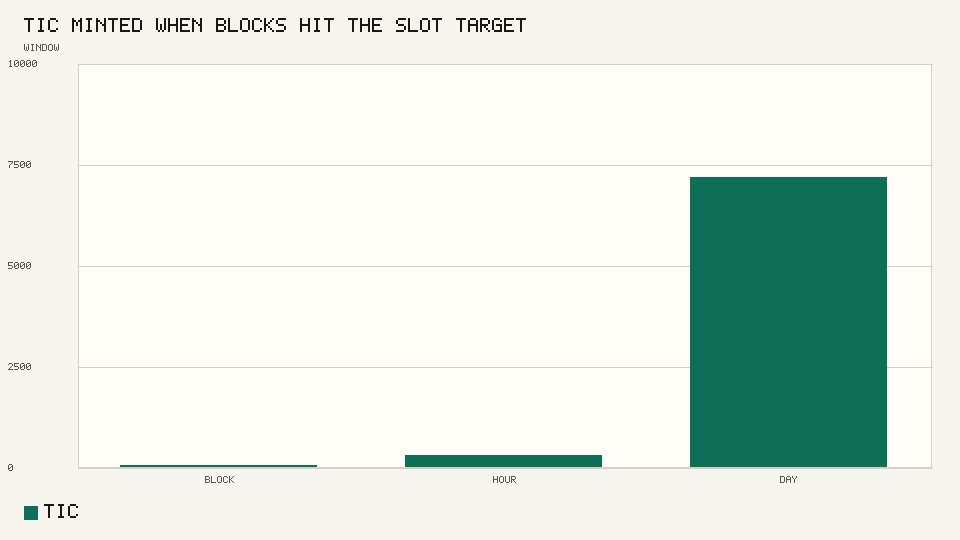
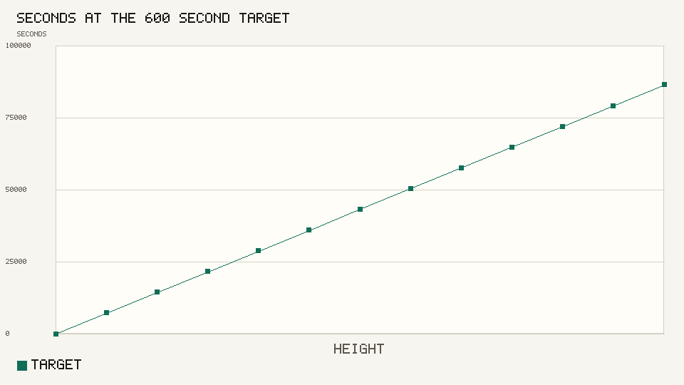
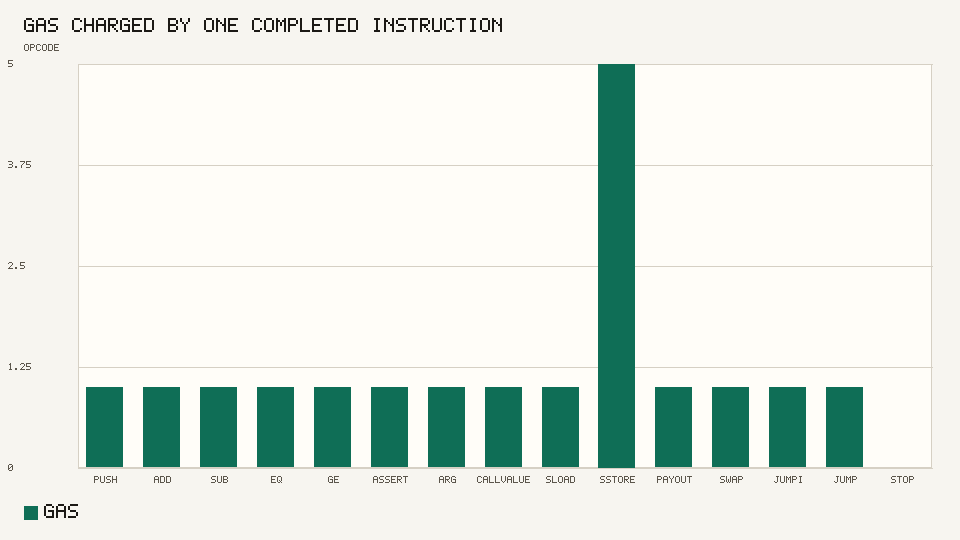
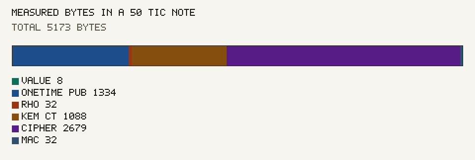
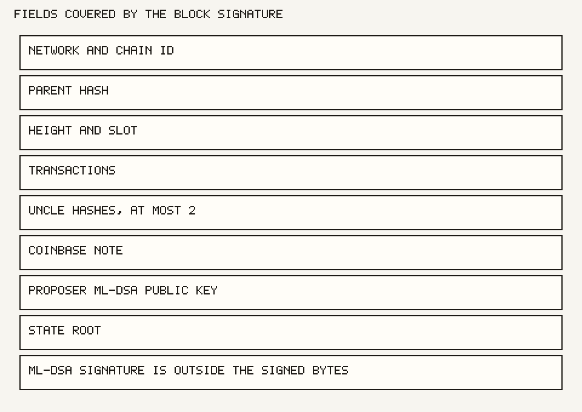
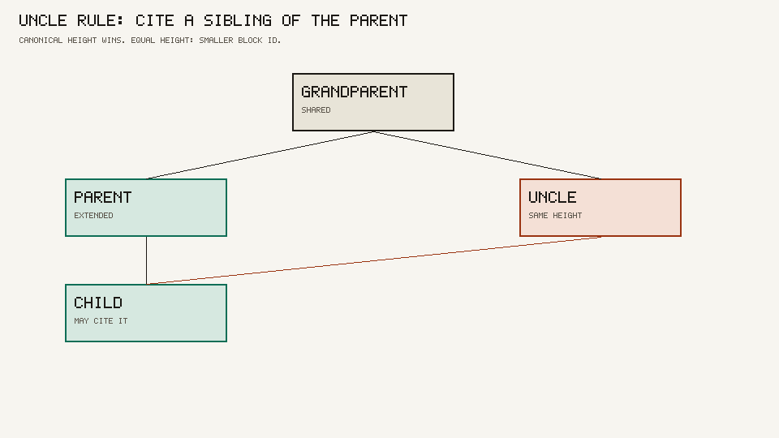
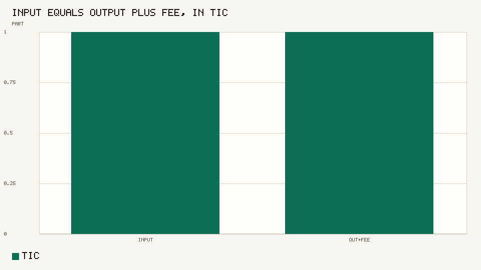

# Timecoin book

Protocol book for the Timecoin layer-1 testnet. The token is Timecoin. The ticker is TIC. This is not a mainnet.

Original node: <https://github.com/9lordisgod/Timecoin>

Organization node: <https://github.com/Timechain-HQ/Timecoin>

| Chapter | Subject |
| --- | --- |
| [State](spec/state.md) | Supply, fees, and the state root |
| [Notes](spec/notes.md) | Commitments, nullifiers, and view keys |
| [Blocks](spec/blocks.md) | Signatures, fork choice, and uncles |
| [Contracts](spec/contracts.md) | Gas, the vault, and conflict waves |

The `reference` package is executable. It checks the issuance schedule, opens a note, and draws the charts.

```bash
python3 -m unittest tests.test_schedule
python3 -m reference.charts
```

1 TIC = 10^8 base units. The reward is 50 TIC. At a 600 second slot, a day is 144 blocks and 7,200 TIC.

















The numbers for the latest run are in [docs/charts/README.md](docs/charts/README.md). The uncle picture is the inclusion rule. A sealed fork with a real block id is in the node repository.

Related code: [wallet](https://github.com/Timechain-HQ/wallet), [contracts](https://github.com/Timechain-HQ/contracts).
