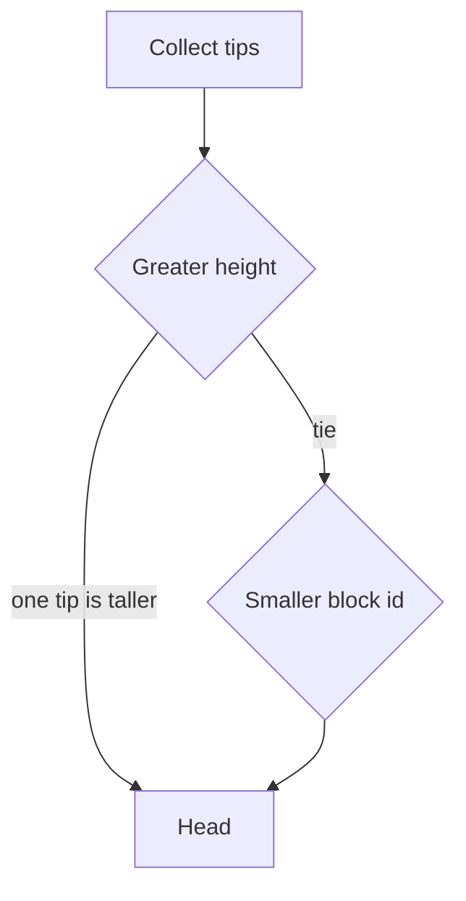
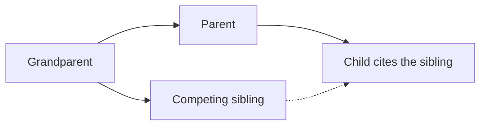

# Blocks

A block binds its parent, height, slot, transactions, at most two uncle hashes, the coinbase note, the proposer key, and the state root. The proposer signs those bytes with ML-DSA-44. The block id is SHAKE-256 over the signed bytes and the signature.

The slot must be greater than the parent slot. The target spacing is 600 seconds. The testnet accepts any increasing slot so a test does not wait.

An uncle shares the parent's parent and the parent's height. The child may cite it. The uncle's transactions are not executed, and its coinbase is not paid on the citing chain.

Block bytes start with `TCBLK1` and a 4-byte length. A second process that has the parent can check the signature and re-execute the block. This version has no gossip layer.
