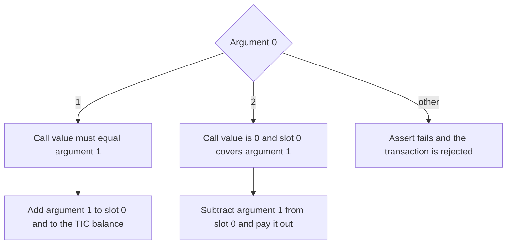
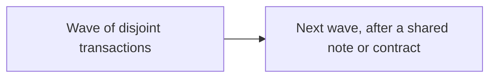

# Contracts

A contract account holds bytecode, an ML-DSA-44 capability key, a TIC balance, and integer storage. A call is valid only when that capability key signs the transaction sighash. There is no external call, so a contract cannot re-enter another contract.



For a call:

```text
inputs = outputs + fee + callvalue - payout
```

`SSTORE` charges 5 gas. `STOP` charges nothing. The other completed opcodes charge 1. The gas limit is 10,000. A revert drops the whole transaction.

Transactions that do not share a note, a nullifier, or a contract id commute. Overlapping transactions stay in block order.


