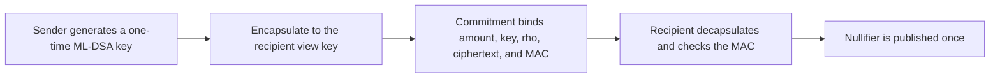

# Notes

A note carries a public TIC amount and a one-time ML-DSA-44 spend key. The long-term ML-KEM-768 view key is not a field in the block. The memo and the one-time spend key sit inside an ML-KEM ciphertext sealed with HMAC-SHA256.

The commitment domain is `timecoin.note.v1`. The nullifier domain is `timecoin.null.v1`. The plaintext starts with `TN1`.

A sender who keeps the one-time key can spend the note until the recipient sweeps it into a new note. After that sweep, the sender's view key does not open the new note.

Amounts stay public. That is how every node rejects an output that pays out more TIC than the inputs, the call value, and the payout allow.
