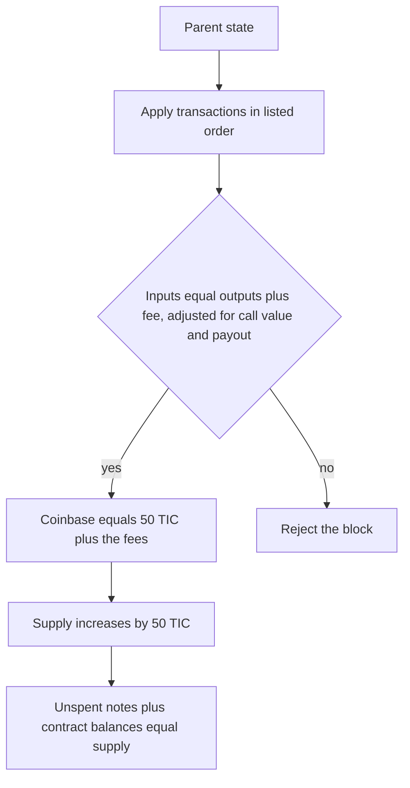

# State

The token is Timecoin. The ticker is TIC. 1 TIC = 10^8 base units. Genesis supply is zero. Each applied block adds 50 TIC. A fee does not mint TIC. It leaves the spent notes and enters the coinbase.

The state root is a Merkle root of three kinds of leaves:

- each unspent note, bound to its commitment and amount
- each published nullifier
- each contract account: code, capability key, TIC balance, and storage

A node stores the blocks and recomputes this root. A balance written into the block file is not state.
